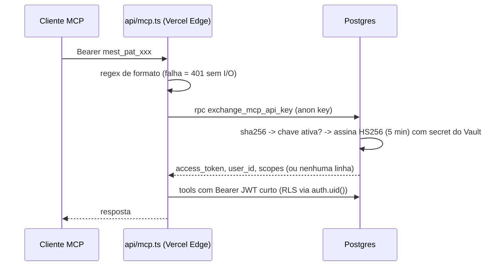

# Tokens persistentes (API Keys) para o servidor MCP

- **Issue:** #36
- **Módulos:** `api/mcp.ts`, `src/mcp/`, `src/lib/mcpKeys.ts`, `src/components/McpKeysSection/`
- **Migration:** `supabase/migrations/20261012_01_mcp_api_keys.sql`
- **Restrição:** apenas recursos do plano gratuito do Supabase (Postgres, pgcrypto, Vault, RLS).

## Problema

O JWT de sessão do Supabase expira em 1h. Clientes MCP (Claude Desktop, Cursor, Antigravity) usam header estático, então a integração quebrava a cada hora.

## Solução: troca da chave por JWT curto dentro do Postgres



### Garantias

| Garantia | Como |
|---|---|
| RLS intacto | JWT emitido tem `role=authenticated`, `sub=user_id`; nenhuma policy existente foi alterada |
| Sem segredo novo no Vercel | Vercel continua só com a anon key; o secret HS256 fica no Supabase Vault |
| Sem `service_role` no MCP | A troca é feita por RPC exposta a `anon`, segura por entropia (256 bits) |
| Revogação imediata | Toda requisição revalida a chave; nada é cacheado |
| Chave nunca persistida em texto | Só `sha256` em `key_hash`; coluna não é legível nem pelo dono |
| Usuário não adultera chaves | Sem INSERT/UPDATE/DELETE para `authenticated`; ciclo de vida só via RPC |
| Expiração obrigatória | 1 a 365 dias (`CHECK` + validação na RPC) |
| Escopos | `read` / `write`; tools de escrita usam `extractWriteContext` |
| Limite | Máximo de 10 chaves ativas por usuário |
| Erros não vazam informação | MCP retorna `401 Unauthorized` genérico; RPC não diz o motivo |

### Formato da chave

`mest_pat_` + 43 caracteres base64url (32 bytes de `gen_random_bytes`). O prefixo próprio facilita secret scanning (gitleaks, GitHub custom patterns).

## Setup obrigatório (uma vez por projeto)

O Postgres precisa assinar tokens que o Supabase aceite (HS256 com segredo conhecido):

1. **Projeto com Legacy JWT Secret:** Dashboard → Project Settings → JWT Keys → copie o *Legacy JWT secret*.
2. **Projeto com JWT Signing Keys:** Dashboard → JWT Keys → *Create standby key* → tipo **HS256 (Shared Secret)** → importe um segredo gerado com `openssl rand -base64 48`. Ative/mantenha a chave como confiável para verificação.
3. No SQL Editor:
   ```sql
   select vault.create_secret('<segredo do passo 1 ou 2>', 'mcp_jwt_secret');
   ```
4. Aplique a migration (`supabase db push`).

Sem o segredo no Vault, `exchange_mcp_api_key` não retorna linhas e o MCP responde 401 (log `mcp_jwt_secret missing in vault` no Postgres).

## Compatibilidade

O fluxo legado com JWT de sessão continua aceito (marcado `@deprecated` em `auth.ts`), mas a UI não expõe mais o token da sessão.

## Limitações conhecidas

- Escopo `write` é aplicado no servidor MCP (o JWT curto nunca sai do servidor). Endurecimento futuro: policies checando `auth.jwt()->'mcp_scopes'`.
- Rotação do segredo do Vault invalida apenas os JWTs de 5 min em voo; as chaves `mest_pat_` continuam válidas.
